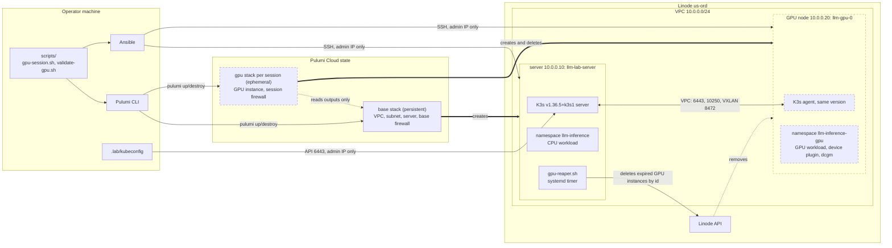

# Architecture

This repo has two layers. It assumes you start from scratch, with no cluster:

1. **The lab** (`infra/`): a disposable Linode K3s cluster with an **on-demand
   GPU worker**. This is the default way in.
2. **The workload** (`manifests/`): a small LLM served by Ollama, deployed with
   `kubectl apply -k`. It is hardware-agnostic, so if you already have a cluster
   you can skip the lab and deploy it there.

What has actually run is recorded in [tested-environments.md](tested-environments.md).
The GPU path passed all 11 validation checks on real hardware on 2026-10-28.
Statements below marked *(unvalidated)* have not run for real yet: a real reaper
deletion and an unattended `up` end to end.

## Overview



Dashed boxes exist only during a GPU session. The default environment is the
persistent base: no GPU instance is running unless an operator approved one.

## 1. The workload

```text
 client ──HTTP──▶ Service llm-inference :80
                      │ targetPort 11434
                      ▼
          Deployment llm-inference (1 replica, strategy Recreate)
          ┌───────────────────────────────────────────────┐
          │ entrypoint.sh (ConfigMap): ollama serve &     │
          │   pull $MODEL_NAME only if missing, then wait │
          │ env from ConfigMap llm-config (MODEL_NAME…)   │
          └──────────────────┬────────────────────────────┘
                             │ /models
                             ▼
                  PVC model-cache (20Gi, RWO)
```

- **Model cache survives restarts.** Weights live on the PVC, and the entrypoint
  pulls only when the model is absent, so a restart reuses the cache and works
  offline. `Recreate` is required because the volume is ReadWriteOnce.
- **Readiness means "model present", not "process up".** The startup probe allows
  about 10 minutes for the first pull; readiness runs `ollama list` and matches
  `$MODEL_NAME`.
- **Security posture:** non-root (UID 1000), no privilege escalation, all
  capabilities dropped, `RuntimeDefault` seccomp, no ServiceAccount token. The
  namespace enforces Pod Security `baseline` and warns on `restricted`.
- **NetworkPolicy:** ingress only from pods in the same namespace on 11434;
  egress only DNS and 443 (model pulls). `kubectl port-forward` is unaffected.
  Enforcement was observed on kind (a pod in another namespace was blocked).

### Base and overlays

`manifests/base` is hardware-agnostic. The overlays differ only in what hardware
requires:

| | `overlays/cpu` | `overlays/gpu` |
|---|---|---|
| Namespace | `llm-inference` | `llm-inference-gpu` |
| Model (placeholder) | `qwen2.5:0.5b` | `llama3.2:3b` |
| CPU / memory (requests → limits) | 2→4 CPU, 4→8Gi | 2→4 CPU, 8→12Gi |
| Accelerator | none | `nvidia.com/gpu: 1` |
| Scheduling | any node | `nvidia.com/gpu.present=true` + toleration |
| Runtime | default | `runtimeClassName: nvidia` |

The GPU overlay uses its own namespace so the CPU demo can keep running next to
it, and tearing down a GPU session is one namespace delete.

### Choosing the target cluster

Scripts never act on whatever kubectl context happens to be current
(`scripts/lib.sh`). They require either `KUBE_CONTEXT=<name>` (existing-cluster
mode) or the lab kubeconfig at `.lab/kubeconfig`, and they print the target
before doing anything. `cleanup.sh` additionally makes you type the context name.

## 2. The lab (`infra/`)

Kubernetes **1.36** via K3s, pinned to one exact release
(`k3s_version` in `infra/ansible/group_vars/all.yml`, currently `v1.36.5+k3s1`)
and shared by every node. Channels and non-1.36 versions are rejected by a guard
in the playbooks, and `validate.yml` asserts that all nodes report the same
version. Region is fixed to `us-ord`.

### Two Pulumi projects, deliberately separate

```text
 infra/pulumi/base  (persistent)             infra/pulumi/gpu  (ephemeral)
 ───────────────────────────────             ──────────────────────────────
 VPC + subnet 10.0.0.0/24                    one stack PER SESSION: gpu-<id>
 K3s server  (public + VPC interface)        GPU instance (public + VPC)
 base firewall                               session firewall
 no GPU resource, ever                       reads base outputs via a
        │                                    read-only StackReference
        └──── outputs (subnet id, cidr, ─────▶ never owns or modifies base
              region, server id)
```

The default environment contains **no GPU instance**. The GPU stack can consume
base outputs but cannot own, modify, or delete the control plane or the shared
network: destroying a session removes only that session's instance and firewall.
No volume or other persistent GPU storage is created; the model cache lives on
the instance disk and disappears with it.

### Network

```text
 admin IP (/32) ──22, 6443──▶ server public iface ┐
                                                  │   VPC 10.0.0.0/24
 server  10.0.0.10 (eth1) ◀══ 6443, 10250, UDP 8472 ══▶ GPU  10.0.0.20 (eth1)
```

- **Nodes talk over the VPC.** Cloud Firewall rules apply to the VPC interface as
  well as the public one, so the base firewall admits node-to-node ports by
  **subnet CIDR**. A node that appears later (the GPU worker) needs no change to
  the base firewall, which the GPU stack is not allowed to edit anyway.
- **A Linode can have only one firewall**, so the GPU node gets its own
  session-owned firewall: SSH from the admin IP, and kubelet / VXLAN from the
  subnet.
- **flannel is pinned to the VPC interface** (`flannel-iface`, derived from the
  host's own VPC address). Without it K3s bound VXLAN to the public `eth0` even
  though `node-ip` was the VPC address, and the firewall would have dropped pod
  traffic. A single node cannot reveal this. Verified on the base server
  (`flannel.1 local 10.0.0.10 dev eth1`), and on the GPU node (`local 10.0.0.20
  dev eth1`); a client on the server node reached a service on the GPU node.
- Only the admin IP can reach SSH and the API. SSH is key-only; no root password.

### Bootstrap (Ansible)

`bootstrap.yml` is server-only: hostname → base packages → K3s server → lab
kubeconfig written to `.lab/kubeconfig`. `gpu-session.yml` joins the worker, in
an order that matters:

1. `gpu_addons` on the server: NVIDIA device plugin and dcgm-exporter as K3s
   `HelmChart` manifests (K3s's built-in Helm controller applies them).
2. `common` then `gpu_runtime` on the GPU node: NVIDIA driver (DKMS), container
   toolkit, reboot. **This must precede the agent**, because K3s detects the
   NVIDIA runtime when it starts.
3. `k3s_agent`: reads the join token from the server at run time, joins, and
   checks that K3s generated an NVIDIA runtime entry.
4. `validate.yml`.

Hostnames boot as `localhost`; the `common` role sets them (`llm-lab-server`,
`llm-gpu-0`) before K3s installs, and K3s uses the same value as the node name.

## 3. GPU session lifecycle (`scripts/gpu-session.sh`)

```text
 plan ─▶ up ───────────────────────────────────────────────▶ active
         │ cost summary (plan, $/hr, hours, estimate)           │
         │ pulumi preview                                       ▼
         │ operator types the session id  ◀── explicit approval down
         │ pulumi up ─▶ Ansible join ─▶ deploy overlay ─▶       │ delete namespace
         │ validate-gpu.sh (11 checks)                          │ destroy stack
         ▼                                                      │ delete Node
   any failure: report stage, stack contents,                   │ remove stack
   instance id, and the exact `down` command                    ▼
   (never auto-destroys, never claims success)             verify (see below)
```

- **Cost and approval.** The plan, hourly rate (Linode's public pricing API),
  requested duration and estimated compute cost are shown first. `up` and `down`
  need a human typing the session id on a terminal; there is no bypass flag.
- **Success is earned.** The session is `active` only if `validate-gpu.sh`
  passes: same K3s version and Ready on both nodes, `nvidia` RuntimeClass, GPU
  allocatable, device plugin running, the pod on the GPU node with one GPU
  allocated, `nvidia-smi` in the pod, an inference request, the model loaded on
  the GPU, a client on the *other* node reaching the Service, `kubectl top
  nodes`, and dcgm-exporter metrics. *(All 11 passed on real hardware.)*
- **Teardown deletes, it does not stop.** The namespace goes first, while the
  node is alive, so the volume is cleaned; then the stack is destroyed.
  `verify` then requires that the instance id returns 404, the session tag lists
  no billable objects, the stack holds no resources, and the base server still
  exists. *(Run on a real session on 2026-10-28: all four checks passed.)*
- **Everything is explicit.** Commands take `--session`, always pass
  `--stack gpu-<id>`, and cross-check the instance id between the session record
  (`.lab/sessions/<id>/`) and the stack before deleting anything.
- One GPU worker at a time (its VPC address is fixed).

### Expiry is enforced by something independent

Expiry tags (`llm-exp-<epoch>`) delete nothing. `scripts/gpu-reaper.sh` is the
enforcement. It depends only on a token (`curl` + `jq`), so it works even if the
session tooling is broken, and it runs as a systemd timer on the control-plane
server so it keeps working while your laptop is off.

It deletes an instance only if **all** hold: the `llm-gpu-session` and
`llm-inference-lab` tags, an `llm-gpu-` label, no `k3s-server` tag, and a passed
expiry. Anything else carrying the marker is reported and left alone. `up`
refuses to provision unless the timer is active.

Trade-off: the reaper token lives on a public host (the timer and units are
verified on a real server; a real deletion is not), and in a shared account it
can reach any Linode in that account (see the decision recorded in
[infra/README.md](../infra/README.md)). The tag and label guards protect against
bugs, not against a compromised host.

## 4. What to read next

- [infra/README.md](../infra/README.md): commands, safety notes, requirement map.
- [tested-environments.md](tested-environments.md): what has run, on what, when.
- [troubleshooting.md](troubleshooting.md): failure modes.
